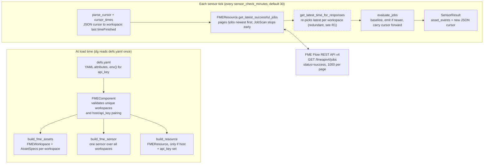

# dagster-fme: Design Spec & Code Review

As of 2026-11-17, reviewed against `main` at `8569d4a`. Fixes for the findings are planned in
[`PLAN.md`](../PLAN.md) (Phases 7 to 10).

## Overview

The design is sound, but the code is still shaped by the port from the monorepo. Removing the leftover
layers would cut about 100 of the 470 source lines and take the sensor tick from five steps to three,
with no change to YAML, asset keys or the cursor. The review also found two real bugs and two
operational risks, listed in the last section.

`dagster-fme` (import `dagster_fme`) is a Dagster Component that represents FME Flow workspaces as
assets. It does not run FME jobs. It polls FME Flow for successful jobs and emits
`AssetMaterialization` events when a workspace finishes a job newer than the one in the sensor cursor.

| Fact | Value |
| --- | --- |
| Source | 5 modules, about 470 lines in `src/dagster_fme` |
| Tests | 82 passing, 100% line and branch coverage (run 2026-11-17) |
| Runtime deps | `dagster>=1.11`, `httpx>=0.27` |
| Python | 3.10 to 3.13 |
| Public API | `FMEComponent`, `FMEWorkspaceSpec`, `FMEResource`, `FMEPaginationLimitError`, `FMEWorkspace`, `build_fme_assets`, `build_fme_sensor` |
| Out of scope | Running jobs, failed-job handling, release automation |

Three parts make up the package:

- **Resource** (`FMEResource`): an `httpx` client for the FME Flow REST API v4 with token auth. It owns
  paging and the newest-first job scan.
- **Assets** (`FMEWorkspace`, `build_fme_assets`): one optional job asset per workspace plus child
  assets nested under the cleaned workspace name.
- **Sensor** (`build_fme_sensor`): turns the latest successful job per workspace into materializations
  and a new JSON cursor.

`FMEComponent` ties them together from YAML, and `FMEComponentScaffolder` writes a starter `defs.yaml`
for `dg scaffold`.

## Architecture and data flow

The package runs in two phases. At load time, YAML becomes asset specs, one sensor and maybe a
resource. On each tick, the sensor turns FME's latest successful jobs into materializations and a new
cursor.



The dashed step is the redundant one that R1 removes. Only the fetch step touches the network, so
every other tick step is a pure function tested without HTTP.

One tick in detail:

1. Read `context.cursor` and parse it into `{workspace: last timeFinished}`.
2. Ask `FMEResource.get_latest_successful_jobs` for the configured workspaces, passing the cursor times
   as `since`. It pages `/jobs?status=success&sort=timeFinished_desc` and stops once each workspace is
   found or the scan has passed its cursor time.
3. Reduce the result to one `LatestJob` per workspace.
4. `evaluate_jobs` compares each job with the cursor. No entry means a baseline, a strictly newer
   finish means one materialization per asset spec, and a configured workspace with no job keeps its
   old entry.
5. Return `SensorResult(asset_events=..., cursor=json.dumps(...))`. Dagster stores the cursor only when
   the tick succeeds, so a failed tick retries from the same point.

## Module reference

Each module has one job. `component.py` depends on the other four, `sensor.py` depends on `assets.py`
and `resource.py`, and `resource.py`, `assets.py` and `scaffolder.py` depend on nothing in the package.

### resource.py: HTTP client and job scan (268 lines)

| Name | Kind | What it does |
| --- | --- | --- |
| `DEFAULT_PAGE_SIZE`, `DEFAULT_MAX_PAGES`, `JOBS_SORT` | constants | 1000 items per page, a 20 page cap, and `timeFinished_desc` |
| `FMEPaginationLimitError` | exception | A `RuntimeError` raised when paging needs more than `max_pages` pages |
| `parse_fme_time(value)` | function | Parses ISO-8601 and turns a trailing `Z` into `+00:00`, which Python 3.10 needs |
| `JobScan` | dataclass | State for one newest-first scan: `targets`, `since`, `found`, `oldest_seen`, `ordered` |
| `JobScan.add_page(items)` | method | Updates `oldest_seen`, sets `ordered=False` if a job is newer than one already seen, and keeps the latest job per target. Raises `ValueError` if a target job has no `timeFinished` |
| `JobScan.is_resolved(ws)` | method | True when the scan is ordered and the workspace was found, or the scan has passed its cursor time |
| `JobScan.unresolved`, `is_complete` | properties | The targets still open, and whether none are left |
| `FMEResource` | resource | Fields `host`, `api_key` (`repr=False`), `api_path` (`/fmeapiv4`), `timeout` (30 s), `page_size` (1 to 1000), `max_pages` (1 or more) |
| `base_url`, `auth_header` | properties | `host` plus `api_path` with slashes normalised, and `Authorization: fmetoken token=<key>` |
| `get_request(client, url, params)` | method | Calls `client.get` then `raise_for_status()` |
| `request_offset_paginated(endpoint, params)` | generator | Opens one `httpx.Client` and yields each page's `Response`. Stops on an empty page or when `offset + len(items) >= totalCount`. Raises `FMEPaginationLimitError` before page `max_pages + 1` |
| `get_latest_successful_jobs(workspaces, since)` | method | Requests `status=success&sort=timeFinished_desc` and feeds pages into a `JobScan` until it is complete. At the page cap it raises only if an unresolved workspace has a cursor time, otherwise it logs a warning. Returns `{workspace: job dict}` |

### assets.py: asset specs (154 lines)

| Name | Kind | What it does |
| --- | --- | --- |
| `DEFAULT_JOB_ASSET_NAME` | constant | `workspace__fmw` |
| `FMEWorkspace` | class | Holds the raw workspace name, a key prefix that already includes the cleaned name, the child specs, and the job asset settings |
| `workspace`, `fqn` | properties | Both return the raw workspace name |
| `asset_name`, `clean_workspace(name)` | property, static method | Replaces every character outside `[A-Za-z0-9_]` with `__` |
| `job_asset_spec` | property | Builds `AssetSpec(key=key_prefix + [job_asset_name])` with `asset_spec_kwargs` and a fixed description |
| `asset_specs` | property | The job spec (unless `include_job_asset=False`) followed by the child specs |
| `build_fme_assets(workspace, key_prefix, asset_list, ...)` | function | Cleans the name, builds child specs keyed `key_prefix + [clean, asset]`, and returns an `FMEWorkspace` whose prefix is `key_prefix + [clean]` |

### sensor.py: decision logic and wiring (218 lines)

| Name | Kind | What it does |
| --- | --- | --- |
| `LatestJob` | TypedDict | `id`, `time_finished` (datetime), `data` (the job dict) |
| `build_materialization_metadata(job)` | pure function | Typed metadata: `fme_job_id`, `workspace`, `repository`, `status`, `time_started`, `time_finished`, `duration_seconds` (from `elapsedTime`, else finish minus start), and `fme_job` as JSON |
| `parse_cursor(cursor)` | pure function | `None` or empty string gives `{}`, otherwise `json.loads` |
| `cursor_times(cursor)` | pure function | Turns cursor strings into datetimes for the resource's `since` |
| `get_latest_time_for_responses(responses)` | pure function | Picks the latest job per workspace and wraps it in `LatestJob`. Raises `ValueError` on a missing `workspace` or `timeFinished` |
| `evaluate_jobs(cursor, latest, fme_assets)` | pure function | Returns `(events, new_cursor)`. First sight records a baseline, a strictly newer finish emits one materialization per spec, configured workspaces with no job keep their entry, and unconfigured entries are dropped |
| `build_fme_sensor(fme_assets, sensor_name, fme_resource_key, minimum_interval_seconds=60)` | factory | Returns a `@dg.sensor` whose body runs: parse cursor, fetch jobs, pick latest, evaluate, return `SensorResult(asset_events, cursor)` |

### component.py: YAML entry point (192 lines)

| Name | Kind | What it does |
| --- | --- | --- |
| `FMEWorkspaceSpec` | `dg.Model` | YAML shape of one workspace: `workspace`, `key_prefix` (`[fme]`), `asset_list`, `include_job_asset`, `job_asset_name` |
| `_doc(description)` | helper | Wraps `dg.Resolver.default(description=...)` so `dg` shows field help. It works around Dagster dropping `Field(description=...)` on fields with defaults |
| `FMEComponent` | Component | Fields `resource_key` (`fme`), `host`, `api_key`, `page_size`, `max_pages`, `fme_asset_specs`, `build_sensor`, `sensor_name`, `sensor_check_minutes` (30). Sets `hide_input_in_errors=True` |
| `_workspaces_are_unique` | field validator | Rejects duplicate `workspace` values (BUG-8) |
| `_resource_settings_are_consistent` | model validator | Requires `host` and `api_key` together, and rejects `page_size` or `max_pages` without them |
| `build_resource()` | method | Returns an `FMEResource` when `host` is set, else `None` |
| `build_defs(context)` | method | Calls `build_fme_assets` per spec, flattens the specs, builds one sensor unless `build_sensor` is False, and adds the resource if there is one |

### scaffolder.py: dg scaffold support (47 lines)

| Name | Kind | What it does |
| --- | --- | --- |
| `STARTER_ATTRIBUTES` | constant | Commented YAML text with one example workspace and a commented `host`/`api_key` block |
| `FMEComponentScaffolder.scaffold(request)` | method | For the `python` format it delegates to Dagster's `scaffold_component`. Otherwise it writes `defs.yaml`, or appends a `---` document when `request.append` is set (1.13 and later) |

`__init__.py` re-exports the seven public names. The `dagster_dg_cli.registry_modules` entry point in
`pyproject.toml` lets `dg list components` find `FMEComponent`.

## Design decisions

The package observes FME and never drives it, so every decision favours a sensor that is cheap per
tick and never emits a false materialization.

| Decision | Choice | Why | Trade-off |
| --- | --- | --- | --- |
| Observe, don't run | The sensor only reads `/jobs` | FME schedules its own jobs, and Dagster only needs lineage and freshness | No run history or logs in Dagster, only materialization events |
| First sight = baseline | A workspace's first finish is recorded with no event | Avoids a flood of events for old jobs when the sensor is first turned on | The first real event waits for the next job to finish |
| Strictly newer | Emit only when `timeFinished` is greater than the cursor | Re-reading the same job never emits twice | Two jobs finishing in one tick produce one event, for the latest |
| Cursor format | JSON `{workspace: ISO-8601 timeFinished}` | Readable, keyed by the raw name FME reports | A breaking change if it ever needs a repository key |
| Carry-forward | Configured workspaces with no job keep their cursor entry, and unconfigured entries are dropped | Fixes BUG-1, so a quiet tick doesn't re-baseline | Removing and re-adding a workspace re-baselines it |
| Job fetching | One query, `status=success`, newest first, early stop (strategy 2) | `workspace` filtering needs `repository`, which specs don't carry | Pages through other workspaces' jobs to reach a quiet one |
| Out-of-order guard | If a page breaks the sort, early stop is turned off | Protects against a server that ignores `sort` | Extra state in `JobScan` for a case the API docs rule out |
| Page cap handling | Raise only when a workspace with a cursor is unresolved | A missed newer job is a correctness bug, a missed baseline is not | One quiet workspace can block every event (see risks) |
| Asset keys | `key_prefix + [clean(workspace), job_asset_name or asset]` | Groups each workspace's assets under one node | `clean_workspace` is lossy: `a.b` and `a-b` both become `a__b` |
| Materialize all specs | A newer job materializes the job asset and every child | FME gives no per-output detail | Children show as updated even if the job wrote nothing to them |
| Typed metadata | `MetadataValue.*` fields plus the full job as JSON | Fixes BUG-3 and renders cleanly in the UI | The full payload is stored on every child event |
| Resource wiring | Component builds `FMEResource` if `host` and `api_key` are set, else uses `resource_key` | Simple YAML-only setup, or sharing one resource | Two config paths to validate and test |
| Secrets | `api_key` is `repr=False`, errors hide input, YAML uses `{{ env('FME_API_KEY') }}` | The token must never reach logs or the UI | None |
| Pure helpers | Cursor and event logic live outside the `@dg.sensor` closure | Unit tests need no Dagster context or HTTP | More small functions than the closure strictly needs |
| Dagster floor | `dagster>=1.11`, tested by a `lowest-direct` CI job | Components API exists from 1.11 | Workarounds such as `getattr(request, "append")` and `project_root` in tests |

## Logic review: what to simplify

Most of the excess is left over from before Phase 4. The resource now returns one latest job per
workspace, but the sensor still aggregates and validates as if it got the raw job list. Items R1 to R4
remove about 100 of the 470 source lines and change no YAML, asset key or cursor contract. R3 changes
the Python `FMEWorkspace` constructor, so it needs approval.

| # | Where | What is over-built | Simplification | Contract impact | Lines saved |
| --- | --- | --- | --- | --- | --- |
| R1 | `sensor.py`: `LatestJob`, `get_latest_time_for_responses` | Re-picks the latest job per workspace from a dict that already holds one per workspace. Re-parses every `timeFinished`. Its two `ValueError` branches can't fire, because `JobScan` already rejects target jobs with no time and only stores jobs with a workspace | Delete both. Pass the resource's `{workspace: job}` straight to `evaluate_jobs` and parse `timeFinished` there | None | about 40 |
| R2 | `sensor.py`: `parse_cursor`, `cursor_times`, `evaluate_jobs` | The cursor is parsed to strings, converted to datetimes for the resource, then each string is parsed again inside `evaluate_jobs`. The `cursor_time = last_time_str` dance exists only to write strings back | One `load_cursor` that returns datetimes and one `dump_cursor`. `evaluate_jobs` works in datetimes and loops over configured workspaces, which also makes the carry-forward rule explicit | None, the JSON on disk is identical | about 15 |
| R3 | `assets.py`: `FMEWorkspace` | Six private attributes behind passthrough properties. `fqn` returns the same value as `workspace`. `__repr__` returns the cleaned name, which hides the class in debugging. `key_prefix` means the prefix plus the cleaned name here, but the prefix alone in `build_fme_assets` | A frozen dataclass with `workspace` and `specs`, built only by `build_fme_assets`. Drop `fqn` and the custom `__repr__` | Python API: `FMEWorkspace(...)` arguments and `.fqn` change. YAML and keys unchanged | about 30 |
| R4 | `resource.py`: `request_offset_paginated`, `get_request` | Built as a general paginator with caller overrides for `limit` and `offset`, but it has one caller that sets neither. It yields `httpx.Response`, so every page is decoded with `.json()` twice. `get_request` is a two-line method | Yield each page's `items` list. Inline `get_request`. Drop the `limit` and `offset` overrides. Use `contextlib.closing` instead of `try/finally: pages.close()` | None, all private | about 15 |
| R5 | `component.py`: `build_resource` | Re-applies `DEFAULT_PAGE_SIZE` and `DEFAULT_MAX_PAGES` that `FMEResource` already defaults | Pass only the fields that are set, so defaults live in one place | None | about 3 |
| R6 | `assets.py`, `component.py` | The default `["fme"]` is written out three times | One `DEFAULT_KEY_PREFIX` constant | None | 0, but one source of truth |
| R7 | `component.py` | `_workspaces_are_unique` sits between field declarations | Move validators below all fields so the YAML schema reads top to bottom | None | 0 |
| R8 | `assets.py`: `job_asset_spec` | The description is an indented triple-quoted string, so it renders with leading newlines and spaces | A one-line f-string | Description text only | about 2 |

### The sensor path after R1 and R2

```python
def load_cursor(raw: str | None) -> dict[str, datetime.datetime]:
    return {ws: datetime.datetime.fromisoformat(t) for ws, t in json.loads(raw or "{}").items()}


def dump_cursor(cursor: Mapping[str, datetime.datetime]) -> str:
    return json.dumps({ws: t.isoformat() for ws, t in cursor.items()})


def evaluate_jobs(cursor, jobs, fme_assets):
    events: list[dg.AssetMaterialization] = []
    new_cursor: dict[str, datetime.datetime] = {}
    for asset in fme_assets:
        ws, prev, job = asset.workspace, cursor.get(asset.workspace), jobs.get(asset.workspace)
        if job is None:
            if prev is not None:
                new_cursor[ws] = prev  # carry forward (BUG-1)
            continue
        finished = parse_fme_time(job["timeFinished"])
        if prev is not None and finished > prev:
            metadata = build_materialization_metadata(job)
            events += [dg.AssetMaterialization(s.key, metadata=metadata) for s in asset.asset_specs]
        new_cursor[ws] = finished if prev is None else max(prev, finished)
    return events, new_cursor


# inside the @dg.sensor closure
cursor = load_cursor(context.cursor)
jobs = fme_resource.get_latest_successful_jobs([a.workspace for a in fme_assets], since=cursor)
events, new_cursor = evaluate_jobs(cursor, jobs, fme_assets)
return dg.SensorResult(asset_events=events, cursor=dump_cursor(new_cursor))
```

The closure drops from five steps to three, and the cursor is parsed once. Existing sensor tests should
pass unchanged. Tests that call `get_latest_time_for_responses` directly would be deleted.

### Looked at and kept

- **`JobScan` as its own class.** It is the one piece of real logic in the resource, and keeping it
  pure lets tests drive it page by page.
- **The out-of-order guard (`ordered`).** The v4 spec documents the sort, so this is defensive. It
  costs about six lines and stops a misbehaving server from causing a missed event, so it is worth
  keeping.
- **`**_resources` and `cast` in the sensor closure.** The resource key is chosen at runtime, so
  Dagster's typed resource parameters can't be used. The comment explains it.
- **The `page_size`/`max_pages`-without-`host` validator.** It is strict, but without it those YAML
  fields would be silently ignored.
- **The `_doc` resolver helper.** It works around a real Dagster behaviour, and a test pins it.

## Bugs, risks and open questions

Two bugs were reproduced against `main` (8569d4a). The two highest risks are both in the job scan: on
a busy server, one quiet or misspelled workspace can make every tick expensive or block the whole
sensor.

| ID | Severity | Where | Issue | Suggested fix |
| --- | --- | --- | --- | --- |
| N-1 | Bug, reproduced | `FMEWorkspace.job_asset_spec` | `asset_spec_kwargs={"description": ...}` raises `TypeError: got multiple values for keyword argument 'description'`, because the description is also passed as its own argument | Merge the default description into `spec_args` before the kwargs, so the caller's value wins |
| N-2 | Bug, reproduced | `FMEWorkspace.__init__` | Built directly, `FMEWorkspace("a b")` keys its job asset `fme/workspace__fmw`, with no workspace segment. Two such workspaces collide | R3: build only through `build_fme_assets`, or add the cleaned name in the constructor |
| N-3 | High risk | `get_latest_successful_jobs` | A workspace with no cursor that is never found (misspelled, or never run) stays unresolved. Every tick then reads all pages up to `max_pages`, as many as 20,000 jobs at the defaults, and logs a warning | Decision needed: record the scan's newest finish as a baseline when a first-sight workspace isn't found, or warn once at load |
| N-4 | High risk | `get_latest_successful_jobs` | A workspace with a cursor that hasn't run in over `page_size × max_pages` successful jobs raises `FMEPaginationLimitError` on every tick. That blocks events for all other workspaces too | Emit events for resolved workspaces and keep the stuck one's cursor, or add the per-workspace strategy 1 query using an optional `repository` on the spec |
| N-5 | Medium | `FMEComponent` validator | Uniqueness is checked on raw names, but `clean_workspace` is lossy. `a.b` and `a-b` pass the check, then fail later with Dagster's less clear duplicate-key error | Also check that cleaned names are unique, and name both workspaces in the error |
| N-6 | Gap | `FMEWorkspaceSpec` | YAML can't set `asset_spec_kwargs` (`group_name`, `owners`, `tags`, `deps`), which the Python API supports | Add an optional `asset_attributes` field, which needs approval as a YAML schema change |
| N-7 | Gap | `FMEComponent` | An in-component resource can't set `timeout` or `api_path` | Add them beside `page_size` and `max_pages`, or document the external resource as the way to set them |
| N-8 | Low | `evaluate_jobs` | A hand-edited cursor with a timestamp that has no timezone raises `TypeError` on comparison with FME's aware times | Treat naive values as UTC in `load_cursor` (R2) |
| N-9 | Low | `FMEComponentScaffolder` | Append mode writes `---` straight after the existing text. A file with no trailing newline produces broken YAML | Write a leading newline when the file doesn't end with one |

### Open questions

- [ ] Are workspace names unique across FME repositories? If not, matching on `repository/workspace`
      changes the cursor format and needs a backwards-compatible reader.
- [ ] Does FME Flow always return `timeFinished` in UTC? The v4 spec only says `date-time`, so the
      parser accepts both `Z` and offsets.
- [ ] For N-3, should a never-seen workspace get a baseline from the scan time? Its first real job
      would then emit an event instead of only recording a baseline.
- [ ] Approve R3 (`FMEWorkspace` constructor change) and N-6 (new YAML field), or leave them as they are.
